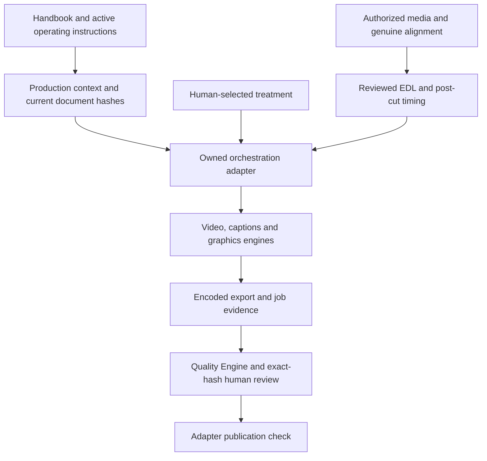

# Architecture

Editing-Pack keeps source instructions and executable tools in the checkout, and each job's data in a separate workspace. `toolkit.json` identifies the source root. [Configuration](configuration.md) chooses external executables and writable locations without searching a private parent repository.

## Source map

| Location | Responsibility |
|---|---|
| `Editing_OS/Skills/Video editing handbook/` | Method and editorial reasoning |
| `Editing_OS/Skills/` | Active instructions, taste template, routing, scene patterns and publication requirements |
| `Editing_OS/Video Editing/Contracts/` | Versioned schemas, semantic validator and synthetic examples |
| `Editing_OS/Video Editing/Engines/Orchestration_adapter/` | Context/evidence checks, bounded render authority and publication check |
| `Editing_OS/Video Editing/Engines/Video editing engine/` | Editorial planning, reviewed EDL execution and timing evidence |
| `Editing_OS/Video Editing/Engines/Captions_engine/` | Word normalization, semantic phrases, selected treatment, ASS/HTML data and caption QA |
| `Editing_OS/Video Editing/Engines/Graphics_engine/` | Semantic cards, layouts, media timing, HTML projects and selected graphics treatment |
| `Editing_OS/Video Editing/Engines/Quality_engine/` | Encoded inspection, evidence/regression requirements and human-review readiness |
| `Editing_OS/Photo editing/Engines/Ideogram4_engine/` | Optional hosted image planning and explicitly cost-gated execution |
| `Editing_OS/Tools/editing-workbench/` | Diagnostics, inventories, frame handoffs, conditional FCPXML and readback comparison |
| `Editing_OS/runtime_paths.py` | Shared root/config/tool/output resolution |
| `config/` | Placeholder config, external package manifest and candidate status |
| `scripts/`, `tests/` | Strict owned checks, controlled export and runtime regressions |

## Authority and files

Load the current master prompt, taste profile, routing, quality standard and handbook for an editing job. A production context records their SHA-256 hashes. The contract validator checks content; the adapter verifies live files and job evidence. Historical advice, external specialist success and an example JSON `approved` value do not establish authority.

Source word times describe original media. Reviewed EDL ranges establish cuts. The timeline map and retimed words describe the resulting output clock. Captions and graphics must consume that same clock, so changing an edit invalidates dependent timing and review evidence.

Treatment is a selected `taste-selection/v1` option. Engines consume selected executable tokens, not a guessed style from a niche label. Encoded bytes receive their own QA and human-review hashes. Changing the export requires matching fresh review.

External tools remain separate processes/packages with their own terms. The toolkit does not vendor specialist clones, install models implicitly, keep credentials in config or own users' media rights. See [optional tools](optional-tools.md) and [privacy](privacy.md).

## How to read the handbook

The handbook is a craft reference; active contracts define execution and publication. [Claim register](../Editing_OS/Skills/Evidence/CLAIM_REGISTER.md) qualifies timing, loudness, platform and style heuristics. Numeric defaults are review starting points unless the current delivery contract establishes them.

Some schema/evidence formats retain arete-prefixed identifiers for compatibility. These are contract identifiers, not a required remote service or private filesystem dependency.
